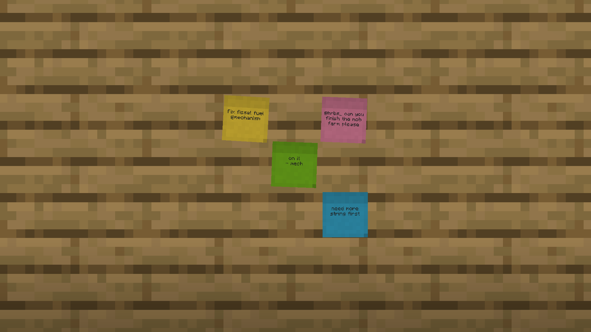

# Note'd

NeoForge 1.21.1 mod. Small colored sticky notes players can stick on any block face* (wall, floor, ceiling) to leave messages for each other.

- Craft: 2 paper + 1 slimeball -> 6 notes. Note + dye -> recolor.
- Up to 9 notes per block face in a 3x3 grid; placed where you click.
- Right-click a note to read/edit it (4 lines, shows author). Page through the face's notes, or Tear Off to take one back.
- Dye a placed note to recolor it; glow ink sac makes the text glow, ink sac removes it.
- Breaking the block drops every note with its text.

Build: `./gradlew build` (Java 21) -> `build/libs/noted-0.1.0.jar`.

*should 
